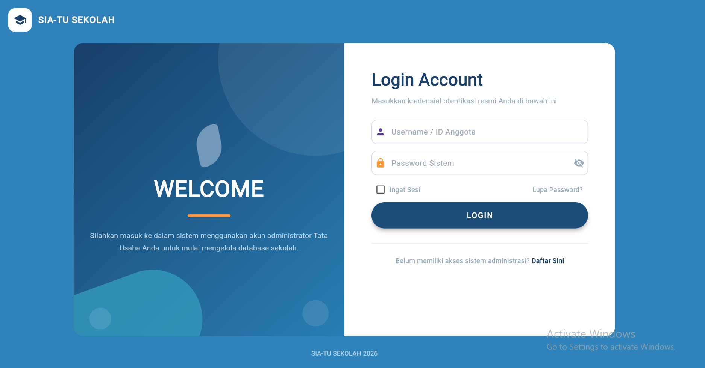
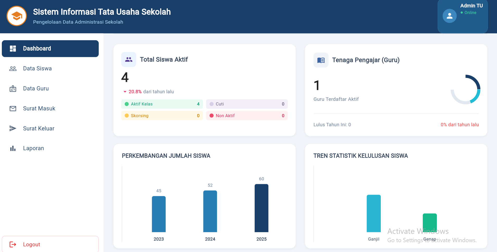
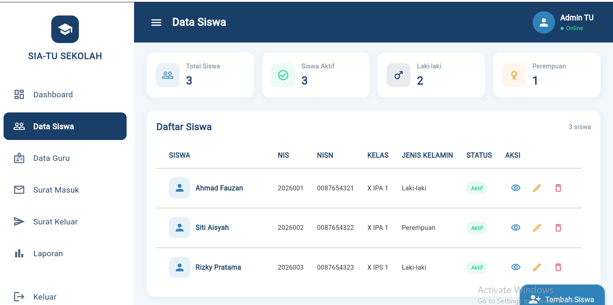
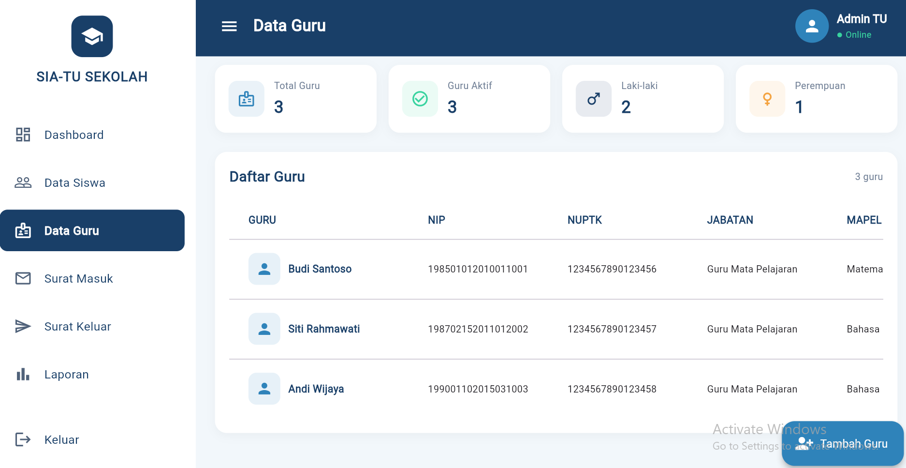
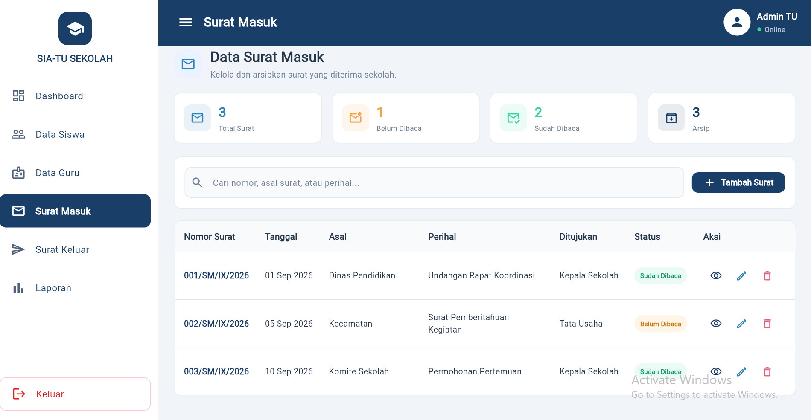

# SIA-TU SEKOLAH
### Sistem Informasi Tata Usaha Sekolah

SIA-TU SEKOLAH adalah aplikasi antarmuka administrasi tata usaha sekolah yang dirancang untuk membantu pengguna mengakses dan melihat informasi administrasi sekolah melalui satu aplikasi. Proyek ini dibuat menggunakan **Flutter** dan **Dart**, dengan tampilan yang mengutamakan navigasi sederhana, informasi yang mudah dibaca, serta tata letak untuk penggunaan melalui browser desktop.

---

## Daftar Isi
- [Gambaran Umum](#gambaran-umum)
- [Tujuan Aplikasi](#tujuan-aplikasi)
- [Fitur dan Halaman](#fitur-dan-halaman)
- [Teknologi](#teknologi)
- [Tangkapan Layar](#tangkapan-layar)
- [Struktur Proyek](#struktur-proyek)
- [Persyaratan Menjalankan Aplikasi](#persyaratan-menjalankan-aplikasi)
- [Cara Mengunduh dan Menjalankan](#cara-mengunduh-dan-menjalankan)
- [Pemeriksaan Sebelum Menjalankan](#pemeriksaan-sebelum-menjalankan)
- [Riwayat Pengembangan](#riwayat-pengembangan)
- [Pengembang](#pengembang)

## Gambaran Umum

Administrasi tata usaha sekolah mencakup pengelolaan informasi siswa, tenaga pengajar, serta surat-menyurat. SIA-TU SEKOLAH menyajikan halaman-halaman tersebut dalam satu antarmuka dengan menu navigasi di sisi aplikasi. Dashboard menampilkan ringkasan informasi, sedangkan halaman data dan surat menyediakan tampilan daftar yang dapat membantu pengguna memahami susunan informasi administrasi.

README ini menjelaskan antarmuka yang terlihat pada screenshot yang disertakan, cara menyiapkan proyek Flutter, dan perintah dasar untuk menjalankannya. Ketersediaan operasi seperti tambah, ubah, hapus, autentikasi, unduh, atau penyimpanan permanen harus dikonfirmasi melalui kode dan pengujian proyek.

## Tujuan Aplikasi

1. Menyediakan antarmuka administrasi sekolah yang memiliki navigasi antarhalaman.
2. Menampilkan ringkasan informasi sekolah melalui dashboard.
3. Menyusun informasi siswa dan guru dalam bentuk daftar/tabel.
4. Menyajikan daftar surat masuk beserta informasi dasar dan status baca.
5. Menyediakan halaman laporan sebagai bagian dari navigasi aplikasi.
6. Menggunakan gaya visual yang konsisten, seperti warna biru tua, latar belakang terang, kartu informasi, ikon, dan label status.

## Fitur dan Halaman

### 1. Login

Halaman login menampilkan identitas SIA-TU SEKOLAH, panel sambutan, kolom **Username / ID Anggota**, kolom **Password Sistem**, opsi **Ingat Sesi**, tautan **Lupa Password?**, tombol **LOGIN**, dan tautan **Daftar Sini**.

Tampilan ini berfungsi sebagai halaman masuk. Mekanisme autentikasi sesungguhnya—misalnya pemeriksaan akun, penyimpanan sesi, pemulihan kata sandi, atau pendaftaran—perlu dipastikan dari implementasi kode dan diuji sebelum disebut aktif.

### 2. Dashboard

Dashboard menyajikan ringkasan visual, antara lain:
- jumlah siswa aktif;
- ringkasan tenaga pengajar;
- kategori status siswa;
- grafik perkembangan jumlah siswa per tahun;
- grafik statistik kelulusan siswa;
- menu menuju Data Siswa, Data Guru, Surat Masuk, Surat Keluar, dan Laporan;
- informasi akun administrator pada bagian atas.

Angka dan grafik pada screenshot merupakan angka yang ditampilkan oleh versi aplikasi yang didokumentasikan. Pastikan sumber angka tersebut sebelum menggunakannya sebagai data resmi sekolah.

### 3. Data Siswa

Halaman Data Siswa menampilkan kartu ringkasan **Total Siswa**, **Siswa Aktif**, **Laki-laki**, dan **Perempuan**. Di bawahnya terdapat daftar siswa dengan kolom:
- nama siswa;
- NIS;
- NISN;
- kelas;
- jenis kelamin;
- status;
- aksi.

Pada screenshot, contoh data yang terlihat mencakup Ahmad Fauzan, Siti Aisyah, dan Rizky Pratama. Nama dan nomor yang terlihat adalah isi screenshot demonstrasi; jangan gunakan sebagai data resmi tanpa verifikasi. Tombol aksi yang terlihat pada baris data juga perlu diuji untuk memastikan perilakunya.

### 4. Data Guru

Halaman Data Guru menyajikan ringkasan **Total Guru**, **Guru Aktif**, **Laki-laki**, dan **Perempuan**. Tabelnya menampilkan:
- nama guru;
- NIP;
- NUPTK;
- jabatan;
- mata pelajaran.

Screenshot memperlihatkan contoh nama Budi Santoso, Siti Rahmawati, dan Andi Wijaya. Data tersebut dicantumkan hanya untuk menjelaskan tampilan antarmuka dan bukan pernyataan bahwa data itu merupakan data sekolah yang sebenarnya.

### 5. Surat Masuk

Halaman Surat Masuk menampilkan judul **Data Surat Masuk**, deskripsi pengarsipan surat yang diterima sekolah, serta kartu ringkasan:
- total surat;
- belum dibaca;
- sudah dibaca;
- arsip.

Tersedia kolom pencarian dengan petunjuk untuk mencari nomor, asal surat, atau perihal, serta tombol **Tambah Surat**. Tabel menampilkan nomor surat, tanggal, asal, perihal, tujuan, status, dan aksi. Contoh baris pada screenshot antara lain surat dari Dinas Pendidikan, Kecamatan, dan Komite Sekolah. Pastikan tombol pencarian, tambah, edit, hapus, dan arsip diuji di aplikasi untuk memastikan fungsi yang sudah benar-benar berjalan.

### 6. Surat Keluar

Menu **Surat Keluar** terlihat pada navigasi. Screenshot halaman Surat Keluar belum disertakan dalam dokumentasi ini. Rincian kolom dan fungsi halaman tersebut perlu diperbarui setelah halaman aktual didokumentasikan dan diuji.

### 7. Laporan

Menu **Laporan** terlihat pada navigasi aplikasi. Halaman ini dimaksudkan sebagai bagian pelaporan administrasi. Screenshot halaman Laporan belum disertakan pada bagian ini; tambahkan screenshot halaman aktual dan jelaskan filter, ringkasan, serta ekspor hanya jika fungsi tersebut tersedia dan sudah diuji.

## Teknologi

Teknologi yang digunakan atau diperlukan untuk proyek ini:
- **Flutter** — framework untuk membangun antarmuka aplikasi.
- **Dart** — bahasa pemrograman Flutter.
- **Material Design / Material widgets** — komponen antarmuka Flutter, jika digunakan pada kode.
- **Git dan GitHub** — pengelolaan versi serta repositori proyek.

Versi Flutter/Dart dan paket yang digunakan mengikuti konfigurasi proyek, khususnya file `pubspec.yaml` dan berkas lock yang disertakan.

## Tangkapan Layar

Screenshot berikut merupakan dokumentasi visual halaman aplikasi. File gambar disimpan di folder `screenshots/` di dalam repositori agar tampil ketika README dibuka di GitHub.

### 1. Halaman Login

Halaman awal aplikasi dengan panel sambutan di sebelah kiri dan formulir login di sebelah kanan. Formulir menyediakan kolom username/ID anggota dan password serta opsi ingat sesi.



### 2. Halaman Dashboard

Dashboard memperlihatkan ringkasan siswa dan tenaga pengajar, kategori status siswa, grafik perkembangan jumlah siswa, grafik statistik kelulusan, serta menu navigasi utama.



### 3. Halaman Data Siswa

Halaman ini menampilkan kartu ringkasan jumlah siswa dan tabel data yang memuat nama, NIS, NISN, kelas, jenis kelamin, status, serta kolom aksi.



### 4. Halaman Data Guru

Halaman ini menampilkan ringkasan jumlah guru dan tabel dengan informasi nama, NIP, NUPTK, jabatan, serta mata pelajaran.



### 5. Halaman Surat Masuk

Halaman ini menampilkan statistik surat, kolom pencarian, tombol tambah surat, serta daftar surat dengan nomor, tanggal, asal, perihal, tujuan, status, dan aksi.



> **Catatan screenshot:** gambar di atas adalah file yang diberikan untuk dokumentasi. Jika tampilan aplikasi berubah, ambil screenshot baru dan ganti file terkait. Hindari menyertakan kata sandi, token, atau informasi pribadi nyata dalam screenshot.

## Struktur Proyek

Struktur umum proyek Flutter biasanya seperti berikut. Nama file di repositori harus disesuaikan dengan struktur yang benar-benar ada pada proyek.

```text
sia_tu_mobile/
├── android/
├── ios/
├── lib/
│   ├── main.dart
│   └── pages/
│       ├── login_page.dart
│       ├── dashboard_page.dart
│       ├── siswa_page.dart
│       ├── guru_page.dart
│       ├── surat_masuk_page.dart
│       └── laporan_page.dart
├── screenshots/
│   ├── login.png
│   ├── dashboard.png
│   ├── data-siswa.png
│   ├── data-guru.png
│   └── surat-masuk.png
├── test/
├── pubspec.yaml
├── pubspec.lock
├── README.md
└── AI_DECLARATION.md
```

